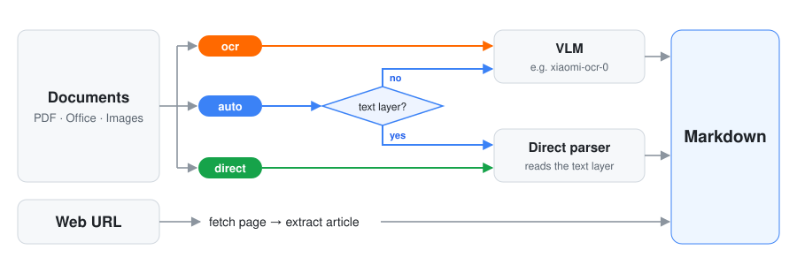

# Any2Markdown

**Convert documents to Markdown — and web pages too.** PDF, Office files and images go in, clean Markdown comes out. Web URLs can be converted to Markdown as well. Recognition is done by a vision-language OCR model, by default [Xiaomi-OCR-0](#recommended-model-xiaomi-ocr-0). Files that already have a text layer can optionally skip the model.

<p align="center">
  
</p>

- **Inputs**: PDF, DOC, DOCX, PPT, PPTX, XLSX, images (JPG / PNG / WEBP / TIFF / BMP), and web URLs.
- **Three parse modes** decide how a document is read; see [Parse modes](#parse-modes).
- **Interfaces**: CLI, Python API, HTTP API and a web UI. The HTTP API and web UI stream results page by page.
- **Any OpenAI-compatible model API** works, and the web UI can switch between several of them.

## Parse modes

The mode is chosen per request: `--parse-mode` on the CLI, `parse_mode` in the API, the mode switch in the web UI. The default comes from `parse.mode` in `any2md.yaml`.

| Mode | What happens | Use it when |
|---|---|---|
| `ocr` | Every page is rendered to an image and recognized by the model. | You want the best fidelity: layout, formulas, tables, text inside figures. This is the web UI default. |
| `auto` | Files with a usable text layer (text-based PDF, DOCX, PPTX, XLSX) are parsed directly. Scans, images and legacy DOC/PPT go to the model. In a PDF that mixes text pages and scanned pages, only the scanned pages are sent to the model. | You have many text-based files and want speed without losing scans. |
| `direct` | Only the direct parsers run (pymupdf4llm, python-docx, python-pptx, openpyxl), with no model call. Fails if the file has no text layer. | You don't have a model available, or need deterministic, instant output. |

The direct parsers read the existing text layer. They cannot recover formulas drawn as images or text inside pictures and charts, and their table and heading detection is heuristic. If quality matters, use `ocr`.

## Install

```bash
pip install -e .
```

LibreOffice is needed to render DOC/PPT, and DOCX/PPTX/XLSX when they go through OCR:

- Ubuntu/Debian: `sudo apt install libreoffice`
- macOS: `brew install --cask libreoffice`

PDFs and images are rendered with PyMuPDF / Pillow and need no system packages. URL fetching for sites with JS challenges uses Playwright: run `playwright install --with-deps chromium` once.

## Usage

### CLI

```bash
any2md input.pdf output.md            # or: any2md input.pdf -o output.md; stdout if omitted
any2md scan.png --parse-mode ocr
any2md report.docx --parse-mode direct
any2md input.pdf --base-url http://gpu-host:8000/v1 --model xiaomi-ocr-0
```

`any2md --help` lists all options (`--dpi`, `--concurrency`, `--table-format`, `--debug-dir`, …).

### Python API

```python
from any2markdown import Any2Markdown

converter = Any2Markdown(base_url="http://localhost:8000/v1", model="xiaomi-ocr-0", parse_mode="ocr")
result = converter.convert("input.pdf")      # or: await converter.convert_async(...)
print(result.markdown)
print(result.parse_mode_used, result.failed_pages)
```

### HTTP server and web UI

```bash
any2md-server                # or: uvicorn any2markdown.server:app --host 0.0.0.0 --port 8088
```

Open <http://localhost:8088/> for the web UI. There you can upload or drop a file, or paste a URL, and pick the parse mode and model. The result streams in page by page, with a timing breakdown (upload, parsing, rendering, model recognition). Models added in the UI are probed for reachability and saved on the server in `server.profiles_file`.

```bash
curl -fsS http://localhost:8088/health

# file → Markdown (form fields parse_mode / model are optional)
curl -X POST http://localhost:8088/convert/file -F "file=@input.pdf" -F parse_mode=ocr

# URL → Markdown
curl -X POST http://localhost:8088/convert/url \
  -H "Content-Type: application/json" \
  -d '{"url":"https://example.com/article"}'
```

Both endpoints have a `/stream` variant (`/convert/file/stream`, `/convert/url/stream`) that returns Server-Sent Events: `stage`, `meta`, one `page` per finished page, then `done`. The module docstring of [`any2markdown/server.py`](any2markdown/server.py) documents the full API, including model profile management under `/models`.

### Docker

```bash
docker build -t any2markdown .

docker run -d --name a2m-server -p 8088:8088 \
  -v "$(pwd)/any2md.yaml:/app/any2md.yaml:ro" \
  -v "$(pwd)/data:/app/data" \
  -e ANY2MD_BASE_URL=http://host.docker.internal:8000/v1 \
  --add-host=host.docker.internal:host-gateway \
  any2markdown
```

- The image already contains `any2md.yaml`. Mount your own over it to change settings without rebuilding.
- `data/` holds the model profiles saved from the web UI, including API keys. Mount it so they survive container restarts, and don't commit it.
- Inside the container, `localhost` is the container itself. To reach vLLM on the host, use `host.docker.internal` as above, or run with `--network host`.

## Recommended model: Xiaomi-OCR-0

[Xiaomi-OCR-0](https://github.com/xiaomi-research/Xiaomi-OCR-0) is a 0.8B document-parsing VLM from Xiaomi, built on Qwen3.5-0.8B and released under Apache-2.0. It outputs Markdown with LaTeX formulas and OTSL tables, which Any2Markdown converts to HTML tables by default. It ranks first on Real5-OmniDocBench (95.24) and scores 96.83 on OmniDocBench v1.6. Weights: [Hugging Face](https://huggingface.co/SeerRay-Lab/Xiaomi-OCR-0) · [ModelScope](https://www.modelscope.cn/models/SeerRay-Lab/Xiaomi-OCR-0).

### Serve it with vLLM

You need a vLLM build that supports `Qwen3_5ForConditionalGeneration`; see the upstream repo for the tested version.

```bash
pip install -U vllm

vllm serve SeerRay-Lab/Xiaomi-OCR-0 \
  --served-model-name xiaomi-ocr-0 \
  --host 0.0.0.0 --port 8000 \
  --max-model-len 16384
# Hugging Face is unreachable? Download first: export VLLM_USE_MODELSCOPE=True,
# or `modelscope download SeerRay-Lab/Xiaomi-OCR-0` and pass the local path.

# check it is up
curl http://localhost:8000/v1/models
```

This matches the defaults in `any2md.yaml` (`base_url: http://localhost:8000/v1`, `name: xiaomi-ocr-0`), so nothing else needs configuring. `--served-model-name` must equal `model.name`. If you start vLLM with `--api-key`, put the same key in `model.api_key`.

Any other OpenAI-compatible endpoint (another vLLM / SGLang model, a hosted API) works too. Point `model.base_url` / `model.name` at it, or add it in the web UI.

## Configuration

The CLI and the HTTP server share a single config file, `any2md.yaml`. The tracked [`any2md.yaml`](any2md.yaml) is a commented example. It has these sections:

| Section | Contents |
|---|---|
| `model` | `base_url`, `api_key`, `name`, `temperature`, `timeout`, `prompt` |
| `render` | `dpi`, `max_image_size` |
| `pipeline` | `concurrency`, `max_retries`, `table_format` (`html` / `otsl`) |
| `parse` | `mode` (`ocr` / `auto` / `direct`) |
| `server` | HTTP server only: `host`, `port`, `url_timeout`, `max_upload_mb`, `pdf_workers`, `profiles_file`, `media_dir`, `public_base_url`; not in the example file (defaults apply): `log_level` (INFO), `image_max_mb` (5), `image_concurrency` (8), `image_timeout` (10), `stream_heartbeat` (15) |

The file is looked up in this order: `--config` → `$ANY2MD_CONFIG` → `./any2md.yaml` → `any2md.yaml` in the project root (`/app` in Docker) → `~/.any2md.yaml`.

**Environment variables** override single keys without editing the file. This is handy for secrets and for `docker run -e`. Each key maps to `ANY2MD_<KEY>`, for example `ANY2MD_BASE_URL`, `ANY2MD_API_KEY`, `ANY2MD_PDF_WORKERS`, `ANY2MD_MAX_UPLOAD_MB`. Two keys are renamed to be unambiguous: `model.name` → `ANY2MD_MODEL` and `parse.mode` → `ANY2MD_PARSE_MODE`.

Precedence: CLI arguments > `ANY2MD_*` environment variables > `any2md.yaml` > built-in defaults.

> **Model profiles in the web UI.** On first start the server creates a `default` profile from `model.*`. After a profile is edited in the UI, `server.profiles_file` is the source of truth for the web UI's models, so later changes to `model.*` no longer affect it. Delete the file to re-seed it.

## How it works

`detect_file_type` → in `auto`/`direct` mode, `direct.try_direct_parse()` returns Markdown per page, or `None` for pages without a text layer → the remaining pages are rendered to images (`renderer.render()`) → `Pipeline` sends them to the model concurrently, with retries → pages are merged in order by `Assembler` → `ConversionResult`.

A page that fails does not abort the document; its index is recorded in `failed_pages`. The HTTP server parses text-layer PDFs in a pool of `server.pdf_workers` processes. The CLI parses in-process.

URLs are fetched with httpx, falling back to headless Chromium for sites that need it. The article is then extracted with site-specific rules or trafilatura. A URL that points to a PDF / Office file goes through the document pipeline above.

## Limitations

Figures and pictures embedded in documents are not handled yet: they are neither extracted as images nor linked from the Markdown output. Support is planned for a future release.
